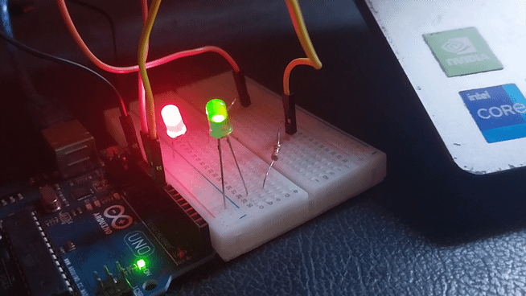

# Independent LED Timing Controller – Arduino

## Overview

This project demonstrates how to control multiple LEDs independently using non-blocking programming with Arduino.

Two LEDs operate with different timing intervals using a single reusable function. The system uses `millis()` to track elapsed time without blocking the main program with `delay()`.

---
## Demo

---
## Hardware Components

- Arduino Uno
- 2 LEDs
- 2 Current-limiting resistors
- Breadboard
- Jumper wires

## Circuit Connections

| Component | Arduino Pin |
|---|---|
| LED 1 | Digital Pin 8 |
| LED 2 | Digital Pin 9 |

Each LED should be connected with a suitable current-limiting resistor.

## Project Behavior

| LED | Pin | Timing Interval |
|---|---:|---:|
| LED 1 | 8 | 500 ms |
| LED 2 | 9 | 1500 ms |

Both LEDs operate independently, with each maintaining its own timing reference and current state.

## Programming Concepts

### 1. Non-Blocking Programming
Using `millis()` instead of `delay()` allows the Arduino to continue executing the main loop while tracking elapsed time.

### 2. Independent Timing
Each LED has its own previous timestamp and timing interval, allowing multiple timing tasks to operate independently.

### 3. Function Reusability
A single `blink()` function controls both LEDs by receiving their pin, interval, timing reference, and state as parameters.

### 4. Pass by Reference
References (`&`) allow the function to modify the original timing and state variables instead of working with temporary copies.

### 5. State Management
Boolean variables track whether each LED is currently ON or OFF.

---

## Learning Outcome

Through this project, I practiced managing multiple independent timing tasks, writing reusable functions, and using references in C++.

It helped me understand how non-blocking programming makes it possible to manage multiple operations within a single Arduino program.

